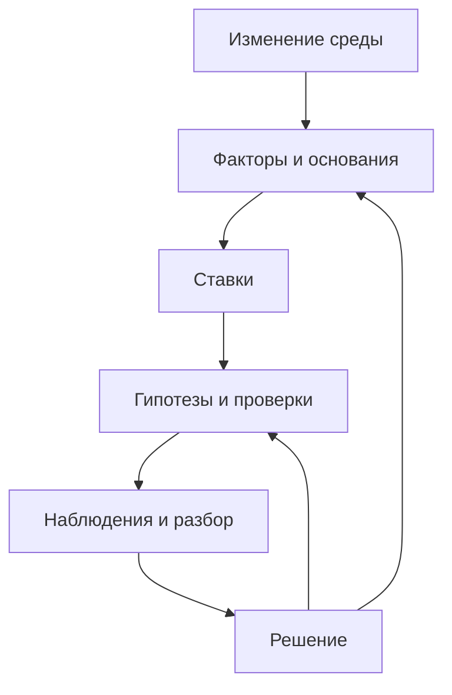

# Цикл пересмотра анализа и стратегии

[База знаний](README.md) → Пересмотр анализа и стратегии

SWOT остаётся полезным, пока его основания сопоставляются с изменившейся средой и результатами собственных действий. Обзор завершается решением или явно назначенным следующим наблюдением, а не только обновлёнными формулировками.

## Два входа в цикл

Первый вход — новое внешнее условие: появилась возможность, усилилась угроза или прежний фактор потерял актуальность. Второй — результат реализации: действие выполнено иначе, проверка выявила другой механизм, обнаружилась способность или ограничение.



Это схема процесса управления. Причинная логика гипотезы раскрывается отдельно: через самостоятельное поведение субъекта и его мотивацию либо прямой механизм, а затем ожидаемый эффект на метрики цели.

## 1. Зафиксируйте исходное состояние

Сохраните объект, горизонт, версии анализа и КГ, существенные формулировки, прогнозы, текущие связи и дату последнего полного успешного обзора. Укажите источники, доступные результаты проверок и человека, который принимает решения.

Для прогноза нужны содержание, основание, горизонт и условие проверки. Один хеш версии без доступного содержания не позволяет сравнить ожидание с результатом. При первом обзоре создайте исходную картину; найденное сегодня не обязательно произошло недавно.

В Социотехе можно использовать историю сущностей и ревизию проекта. Читайте историю с учётом страниц результата; проверьте, что нужный период действительно покрыт. Неизменная ревизия карты ничего не говорит об изменениях внешнего мира. Подробнее — [история ставки через MCP](sociotech-mcp.md#история-ставки-и-регулярный-пересмотр).

## 2. Сравните основания и наблюдения

Для внешних факторов различите дату события, публикации и проверки. Найдите, что именно изменилось: условие, качество данных или интерпретация. Прогноз из статьи не становится произошедшим событием.

Одновременно прочитайте доступные результаты проверок: версию гипотезы, фактическое воздействие, охват, окно наблюдения, расход ресурса, целевые и балансирующие метрики. Статус «задача выполнена» описывает работу и не доказывает эффект.

Для фактических рядов Социотеха используйте отдельное чтение измерений. Ожидаемое изменение в связи гипотезы с метрикой, её плановое значение и датированный замер — разные данные. Их [представление в MCP](sociotech-mcp.md#переход-в-кг-и-представление-эффекта) должно сохранять это различие.

Сравнивайте сопоставимые данные. Изменившиеся сегмент, формула, период или охват могут объяснять разницу без изменения механизма. Если источник недоступен, отметьте пробел; отсутствие свежей информации не равно отсутствию изменений.

## 3. Найдите затронутые зависимости

От изменившегося фактора пройдите ко всем связанным ставкам, затем к гипотезам, субъектам или прямым механизмам, целям и метрикам. От результата проверки пройдите в обратную сторону к предположениям и факторам.

Используйте реальные идентификаторы и [связи происхождения](hypothesismapping.md#сохранение-связи-и-происхождения). Одинаковый текст не подтверждает связь. Если переход отсутствует, это пробел модели; он не доказывает, что влияния нет.

Существенное изменение может затронуть несколько ветвей. Не ограничивайтесь одной удобной ставкой. Вместе с внешним условием проверьте, сохранились ли внутренние способности и ресурс для выбранного действия.

## 4. Определите, что именно узнали

| Наблюдение | Допустимый вывод и следующий шаг |
| --- | --- |
| Воздействие не создано или не дошло до нужного объекта | Разобрать исполнение, ресурс и дизайн проверки; механизм мог остаться непроверенным |
| Данных мало, окно не завершено или доступ неполон | Сохранить неизвестное и организовать получение данных; не объявлять фактор ложным |
| Механизм не сработал при достаточной проверке | Пересмотреть конкретную гипотезу и её предпосылки в проверенных условиях |
| Изменилось внешнее условие | Обновить соответствующий фактор и проверить все существенно зависимые ставки |
| Обнаружилась собственная способность или ограничение | Уточнить внутренний фактор, сохранив контекст и предел обобщения |
| Целевая метрика улучшилась, но нарушена балансирующая граница | Применить согласованную реакцию и разобрать цену результата; не объявлять безусловный успех |
| Изменение могло возникнуть по нескольким причинам | Сохранить конкурирующие объяснения и предел вывода о вкладе гипотезы |

Эти варианты могут сочетаться. Например, внешнее изменение могло помешать выполнить воздействие. Тогда фиксируются оба обстоятельства; вывод «люди не захотели» без наблюдения их выбора необоснован.

Успех в одном сегменте не подтверждает масштабирование на весь рынок. Один срыв личного занятия не доказывает постоянную слабость человека. Подробности измерения — в [проверке гипотез КГ](https://github.com/Byndyusoft/hypothesismapping/blob/main/metrics.md).

## 5. Подготовьте сигнал для решения

Сигнал должен объяснять последствия изменения, а не просто пересказывать новость.

```text
Проект, период и исходные версии:
Изменение: было → стало:
Источник, дата события и дата проверки:
Затронутые ID факторов, ставок, гипотез и метрик:
Какая предпосылка или граница требует внимания:
Факты, интерпретация, неизвестное и альтернативные объяснения:
Варианты следующего действия:
Цена задержки и известный срок решения:
Кто рассматривает сигнал:
Принятое решение или следующее наблюдение:
```

Шаблон можно хранить в заметке или протоколе; отдельная карточка нотации не требуется. Срочность определяют по последствиям и доступному времени, без выдуманных универсальных порогов.

Для решения по конкретному фактору или ставке доступно описание карточки; ответственного за проработку можно назначить из участников проекта. Само назначение не подтверждает настройку нужного канала уведомлений или расписания. Используйте [описания и ответственных](sociotech-mcp.md#описания-карточек-и-ответственные), сохраняя ранее записанные основания.

Повторяющиеся сообщения об одном событии объединяйте, сохраняя новые свидетельства. Отсутствие существенных изменений также допустимый результат. Не создавайте находки ради регулярного отчёта.

## 6. Примите и выполните решение

Возможные решения: продолжить, наблюдать, исследовать, изменить проверку, пересмотреть гипотезу или ставку, изменить ресурс, приостановить, закрыть либо вернуться к цели.

Сохраните автора решения, дату, основание, затронутые версии, следующий шаг и срок или событие возврата. Новые данные и рекомендация ИИ ещё не являются принятым решением. При изменении оценки эффекта разделяйте условный потенциал, прогноз и критерий ближайшей проверки.

Если изменения в проекте уже поручены, выполняйте их в согласованных пределах. Перед записью проверьте, не изменилась ли существенная часть модели после чтения. При конфликте перечитайте её и пересмотрите предложение. После записи проверьте обновлённые элементы и связи.

Если исправления пришли из встроенной AI-проверки, различайте завершение обработки, ожидающую рекомендацию и фактически применённое изменение. Пакетное принятие не отменяет проверку каждого результата. См. [порядок разбора рекомендаций](sociotech-mcp.md#аудит-встроенная-проверка-и-применение-рекомендаций).

Проверьте также активные задачи на приостановленной или закрытой ветке. Их продолжение должно соответствовать решению либо иметь отдельное объяснение. Историю отрицательных результатов и прежних ожиданий сохраняйте.

## 7. Настройте следующий обзор

Ежемесячный обзор — возможный старт, если он соответствует скорости среды. Нарушение важной границы, утрата ключевой предпосылки или новый результат проверки могут требовать внепланового разбора. Критичное событие не должно ждать условной даты месяца.

Определите конкретные источники, период, часовой пояс, события для сигнала, получателя и разрешённый канал. Если обзор частичный, сохраните фактический охват и остаток работы. Дату последнего полного успешного обзора не сдвигайте так, будто пропусков не было; следующий проход должен закрыть пропущенный период.

Навык агента описывает способ работы. Планировщик, доступ к данным и доставка результата настраиваются отдельно. Подробности — в [работе с ИИ](ai-agents.md).

## Личная и семейная стратегия

Изменившееся расписание доступного занятия — повод пересмотреть внешнее основание и способ действия. Оно не доказывает отсутствие желания заниматься. Появление свободного времени — наблюдение о средстве, а удовлетворённость свободой или интересом к жизни — отдельный результат.

Если нижний результат получен, а субъективная оценка не изменилась, проверьте связь между ними, окно наблюдения и смысл цели. Не превращайте ожидаемое переживание в обязательство. Участие близких и распространение личных наблюдений требуют согласованных договорённостей.

Развёрнутый [личный пример](examples.md#personal) показывает разделение внешнего изменения, исполнения и верхнего результата.

Связанные разделы: [факторы](factors.md), [ставки](bets.md), [личная стратегия](personalstrategy.md), [обратная связь в базе КГ](https://github.com/Byndyusoft/hypothesismapping/blob/main/analysisfeedback.md).
